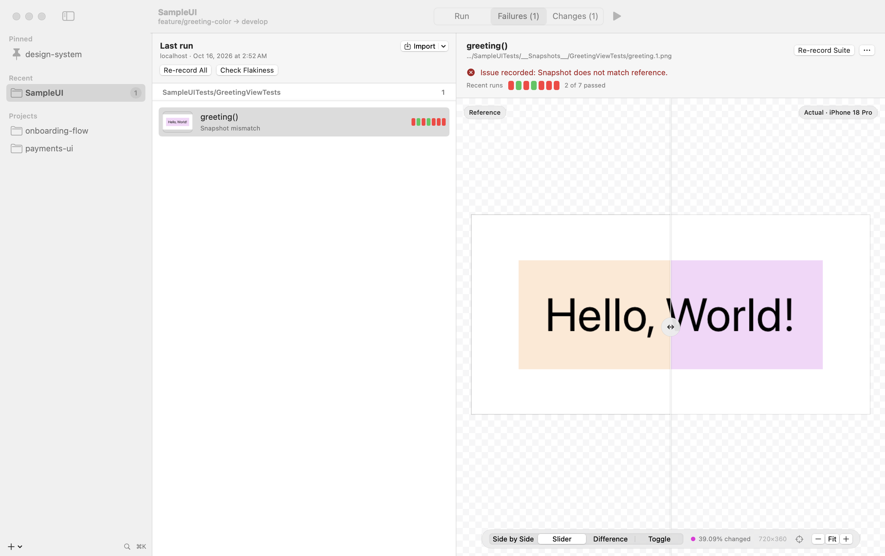
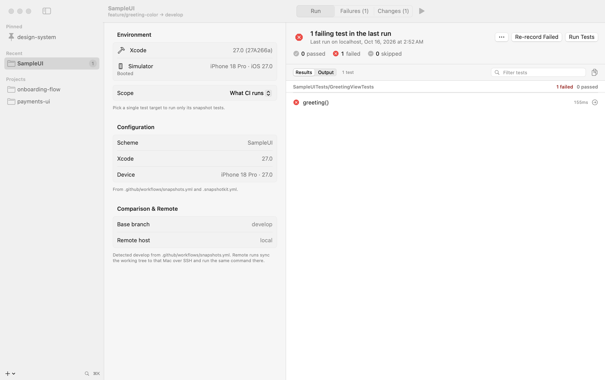

# SnapshotKit

[](https://github.com/TobiasRe/SnapshotKit/actions/workflows/ci.yml)
[](LICENSE)



A macOS app (and `snapkit` CLI) for dealing with failing and flaky iOS snapshot tests built with
[swift-snapshot-testing](https://github.com/pointfreeco/swift-snapshot-testing):

- **Run** a module's snapshot tests with exactly the configuration your CI uses, with live output and pass/fail counts.
- **Re-record** only the failing suites, then verify the new references.
- **Investigate failures**: reference vs. actual vs. difference, also for a `.xcresult` downloaded from CI.
- **Tell noise from real changes**: each difference is diagnosed (invisible, a few pixels, size changed, visible),
  with the `precision`/`perceptualPrecision` that would pass, a pixel inspector and zoom to the change.
- **Tell flaky from broken**: rerun failing tests N times; each test shows a strip of its recent runs, and run
  history flags tests that both passed and failed on the same commit.
- **Run on a CI machine** over SSH, to reproduce failures that only happen there.
- **Review changes**: every PNG that differs from the base branch, grouped by suite, with side-by-side, slider,
  difference and toggle views, *Viewed* marks like a code review, and a one-click discard for re-records that only
  picked up rendering noise.

Runs on macOS 14 or later and needs Xcode 16 or later for the projects it tests (for
`xcresulttool get test-results`). Building SnapshotKit itself needs Xcode 26 or later.

## Install

**From a release:** download `SnapshotKit-<version>-macos-arm64.zip` (and optionally the `snapkit` CLI) from
[Releases](https://github.com/TobiasRe/SnapshotKit/releases), unzip, and move `SnapshotKit.app` to
Applications. The app is ad-hoc signed, not notarized, so macOS blocks the first launch: open it once, then
choose **Open Anyway** in System Settings › Privacy & Security, or run
`xattr -dr com.apple.quarantine SnapshotKit.app`.

**From source:**

```bash
git clone https://github.com/TobiasRe/SnapshotKit.git && cd SnapshotKit
scripts/make-app.sh          # builds dist/SnapshotKit.app and dist/snapkit
open dist/SnapshotKit.app
```

## Quick start

Add a repository (⌘O, or drop its folder onto the window), or a folder to scan (sidebar **+** › Add Scan
Folder). The sidebar shows each project's failing count from its last run. Then:

| | |
|---|---|
| ⌘R | Run snapshot tests |
| ⇧⌘R | Re-record failed suites |
| ⌥⌘R | Check flakiness of failed tests |
| ⌃⌘R | Run on the remote machine |
| ⌘. | Cancel |
| ⇧⌘O | Import an `.xcresult` (e.g. a CI artifact) |
| ⌘K | Quick switch project |
| ⌥⌘1 / ⌥⌘2 / ⌥⌘3 | Run / Failures / Changes |
| ⌘1 – ⌘4 | Side by side / slider / difference / toggle |
| ⌘= / ⌘− / ⌘0 | Zoom in / out / fit. Pinch to zoom, two-finger or mouse drag to pan, double-click to reset |
| ⇧⌘0 | Zoom to the changed pixels |
| ← / → | Move the slider divider (or drag its knob) |
| Space | Flip between the images in toggle mode |
| ⌥⌘↓ / ⌥⌘↑ | Next / previous failure or change, wherever the focus is |
| V (in the list), ⌥⌘V | Mark a change as viewed and go to the next one |

Right-click a failing test to check just that test for flakiness, re-record its suite, reveal the
reference or copy its identifier and failure message. Right-click a changed snapshot to open or reveal it,
open the base branch version, or discard an unwanted working-tree change. The Changes tab picks the base
branch from a menu, and you can switch to comparing against the branch tip. The dock icon shows the
failing count, and bounces when a run finishes in the background.

The same features are on the command line:

```bash
snapkit config            # show the resolved configuration and where each value came from
snapkit run               # run like CI; exits 1 on failures and names failing suites
snapkit rerecord          # re-record the last run's failing suites and verify
snapkit flaky --iterations 10
snapkit failures --xcresult ~/Downloads/ci.xcresult   # diagnoses each failure, shows recent runs
snapkit history 'AppSnapshotTests/CardTests/card()'   # one test's runs: ✔ ✘ ◐
snapkit diff reference.png failure.png                # "No visible difference … perceptualPrecision: 0.99"
snapkit changes --filter dark
snapkit run --remote      # on the machine in remoteHost
```

## Configuration

SnapshotKit reads `.gitlab-ci.yml` (plus local `include:` files), `.github/workflows/*.yml`, and shell
scripts those call. From the `xcodebuild … test` invocation that looks most like a snapshot job, it takes
`-scheme`, `-workspace`/`-project`, `-testPlan`, `-destination` (device and OS), `-only-testing` and
`-skip-testing`, plus a preceding `cd`. Variables (`$VAR`, `${VAR}`, `${{ env.VAR }}`) are expanded.
The Xcode version comes from `xcode-version:`, `Xcode_X.Y.app` paths, `*XCODE*VERSION*` variables,
`xcodes select`, or image tags. The base branch comes from the MR/PR target branch, or else from `origin/HEAD`
(falling back to `develop`/`main`/`master`).

If Xcode or the simulator is missing, you get an error saying what is required, by which file, what is installed, and how to fix it.

Anything can be overridden in `.snapshotkit.yml` at the repository root:

```yaml
xcode: "<version>"          # or developerDir: /Applications/Xcode.app
device: <simulator name>
os: "<iOS version>"         # or latest
scheme: App
workspace: App.xcworkspace  # or project: App.xcodeproj
testPlan: SnapshotTests
onlyTesting: [AppSnapshotTests]
skipTesting: []
baseBranch: develop
workingDirectory: .
extraArguments: -configuration Debug
remoteHost: ci-mac-1        # SSH host or ~/.ssh/config alias
remoteDirectory: ~/snapshotkit/app
```

Per-project settings in the app (base branch, remote host, module) override both. App settings are stored as
JSON in `~/Library/Application Support/SnapshotKit/` (`SNAPSHOTKIT_HOME` overrides the location).

## Screenshots

| | |
|---|---|
|  |  |
| Failures: what kind of difference each one is, and a strip of its recent runs | Changes since the base branch, with *Viewed* marks |
|  |  |
| Rendering noise, explained, with the precision that would pass | The configuration CI uses, and the last run's results |

## Noise or a real change?

Hover an image to read the pixel under the pointer on both sides and their colour difference (CIE94 ΔE, the
measure `perceptualPrecision` uses; below about 2.3 nobody can see it). Every comparison is classified:

- **Invisible**: pixels differ, none visibly. Typical of a reference recorded on another machine, GPU or OS
  version. Re-recording locally just moves the problem, so record where CI runs, or relax `perceptualPrecision`
  to the suggested value.
- **Few pixels**: a handful of visible pixels, often anti-aliasing, a caret or a timestamp.
- **Size changed**: a different device, scale or layout.

The Failures list shows this next to each test, along with a strip of its recent runs (green passed, red failed,
orange when repetitions disagreed). A flaky test reads as a broken pattern, a regression as a clean switch to red.

## How re-record works

1. The failing suites come from the last run (`.git/snapshotkit/last-run.json`, shared by the app and CLI).
   If there is no last run, the tests run first.
2. SnapshotKit finds each suite's source file (from the failure location, or by searching for its declaration).
   It **refuses** to continue if any of those files has uncommitted changes.
3. It writes a journal with the original contents to `.git/snapshotkit/record-patch.json`, then patches the record trait:
   - Swift Testing: `@Suite(.snapshots(record: .all))` (it adds the attribute or trait, or replaces an existing `record:` value).
   - XCTest: an `invokeTest()` override wrapping the test in `withSnapshotTesting(record: .all)`.
4. It runs only those suites (`-only-testing:Target/Suite`), then restores the files. It then runs the suites again
   without the patch to verify the new references.

The patch is always undone: on success, error, cancel, Ctrl-C, `SIGTERM`/`SIGHUP` (child `xcodebuild` is stopped
first), and app quit. If the process is killed outright, the next launch of the app or any `snapkit` command restores it.
If a patched file was edited during the run, only SnapshotKit's change is removed and your edits are kept. If that is
impossible, the file is left alone, the original is saved under `.git/snapshotkit/backups/`, and you get a warning.

## Remote runs

With `remoteHost` set, SnapshotKit uses key-based SSH (it never asks for passwords) and does the following:

1. Checks that the remote has the Xcode and simulator CI expects.
2. Rsyncs the working tree (tracked and untracked, not ignored files) to a cache directory.
3. Runs the same `xcodebuild` command there with streamed output. Cancelling stops the remote run.
4. Brings back the results and failure images.

**Re-record on remote** patches only the remote copy and downloads the newly recorded PNGs into your working tree,
so you get references rendered on the CI machine. `remoteHost: local` uses a local directory instead of SSH,
which is handy for trying the workflow out.

## Development

```bash
swift test                              # core unit tests + the app's own snapshot tests
scripts/e2e.sh [--keep]                 # end to end against a real simulator (sample package, ~10 min)
scripts/capture-ui.sh <repo> [out-dir]  # headless full-window screenshots of every view
```

The app's UI is covered by snapshot tests (swift-snapshot-testing with Swift Testing) in
`Tests/SnapshotKitAppTests`. They render real views from fixture state in light and dark. Liquid Glass
can't be composited off-screen, so those renders use an opaque stand-in and leave out the system toolbar
and sidebar chrome. To update references, delete the PNG or set `record: .all`, or re-record them with
SnapshotKit itself. Visual guidelines are in [docs/DESIGN.md](docs/DESIGN.md).

`SnapshotKitCore` holds all the logic: config, process runner, xcresult parser, git, record-patch manager,
remote runner and project store. `SnapshotKit` (SwiftUI) and `snapkit` are thin front ends.
`SnapshotKit --capture out.png --project <repo> --tab changes --compare slider --zoom 3` renders the window
off-screen without activating the app.

## License

MIT, see [LICENSE](LICENSE).
