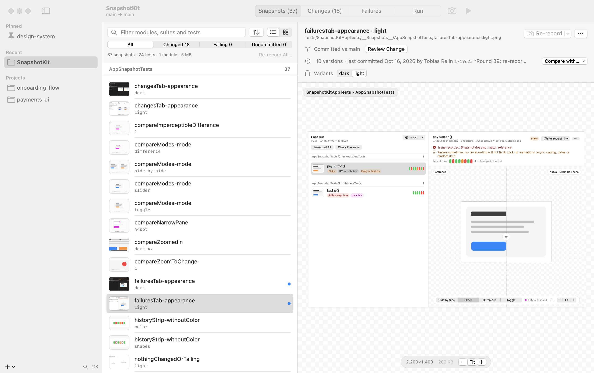

# SnapshotKit

[](https://github.com/TobiasRe/SnapshotKit/actions/workflows/ci.yml)
[](LICENSE)

**[Website](https://tobiasre.github.io/SnapshotKit/) · [Documentation](docs/README.md) · [Download](https://github.com/TobiasRe/SnapshotKit/releases/latest) · [Changelog](CHANGELOG.md)**



A macOS app (and `snapkit` CLI) for inspecting, managing and updating the reference images of iOS snapshot
tests built with [swift-snapshot-testing](https://github.com/pointfreeco/swift-snapshot-testing):

- **Browse and inspect** every snapshot in a project by module, test file and test, as a list with a large
  preview or as a grid. See variants (light/dark, devices, named states) side by side, a snapshot's history
  across commits, its size, and the pixel under the pointer.
- **Review changes**: every snapshot that differs from the base branch, with side-by-side, slider, difference
  and toggle views, *Viewed* marks like a code review, and one-step discard of re-records that only picked up
  rendering noise.
- **Update**: re-record any test, suite or filtered set of snapshots (not just failing ones), with the source
  patch always restored and the result verified.
- **Manage**: find orphaned snapshots whose test is gone, the largest images, what's new or modified; copy or
  drag snapshots and side-by-side comparisons into a review.
- **Failing and flaky tests** are part of the same picture: reference vs. actual vs. difference (also for an
  `.xcresult` from CI), a diagnosis of each difference (invisible, a few pixels, size changed) with the
  `precision`/`perceptualPrecision` that would pass, flakiness checks and each test's recent runs.
- **Run like CI**, locally or on a CI machine over SSH, with exactly the configuration your pipeline uses.

Runs on macOS 14 or later and needs Xcode 16 or later for the projects it tests (for
`xcresulttool get test-results`). Building SnapshotKit itself needs Xcode 26 or later.

## Install

**From a release:** download `SnapshotKit-<version>-macos-arm64.zip` (and optionally the `snapkit` CLI) from
[Releases](https://github.com/TobiasRe/SnapshotKit/releases), unzip, and move `SnapshotKit.app` to
Applications. The app is ad-hoc signed, not notarized, so macOS blocks the first launch: open it once, then
choose **Open Anyway** in System Settings › Privacy & Security, or run
`xattr -dr com.apple.quarantine SnapshotKit.app`.

**From source:**

```bash
git clone https://github.com/TobiasRe/SnapshotKit.git && cd SnapshotKit
scripts/make-app.sh          # builds dist/SnapshotKit.app and dist/snapkit
open dist/SnapshotKit.app
```

## Quick start

Add a repository (⌘O, or drop its folder onto the window), or a folder to scan (sidebar **+** › Add Scan
Folder, or drop a folder that isn't a repository). Scanning looks six folders deep for git repositories with
`__Snapshots__` images, a `.snapshotkit.yml`, or a dependency on swift-snapshot-testing, and says what it
found. A project opens on its snapshot library. The sidebar shows each project's failing count from its
last run.

| | |
|---|---|
| ⌘R | Run snapshot tests |
| ⇧⌘R | Re-record the selected test (snapshot, change or failure) |
| ⌥⇧⌘R | Re-record all failing tests |
| ⌥⌘R | Check flakiness of failing tests |
| ⌃⌘R | Run on the remote machine |
| ⌘. | Cancel |
| ⇧⌘O | Import an `.xcresult` (e.g. a CI artifact) |
| ⌘K | Go to a project or run a command |
| ⌘F | Filter the list (Escape clears the filter, then leaves the field) |
| ⌥⌘1 – ⌥⌘4 | Snapshots / Changes / Failures / Run |
| ⌘1 – ⌘4 | Side by side / slider / difference / toggle |
| ⌘= / ⌘− / ⌘0 | Zoom in / out / fit. Pinch to zoom, two-finger or mouse drag to pan, double-click to reset |
| ⇧⌘0 | Zoom to the changed pixels |
| ← / → | Move the slider divider (or drag its knob) |
| Space | Quick Look the selected snapshot (in a list); flip between the images in toggle mode |
| ⌘C | Copy the selected snapshot (in a list) |
| ⌥⌘O | Open the selected snapshot's test in Xcode, at its function |
| ⌥⌘↓ / ⌥⌘↑ | Next / previous failure or change, wherever the focus is |
| V (in the list), ⌥⌘V | Mark a change as viewed and go to the next one |

In the library, filter by name and narrow to **Changed**, **Failing**, **Uncommitted** or **Orphaned**
snapshots; sort by size or recency; switch between list and grid. A snapshot's detail lists its variants
and committed versions to compare against, and links to its change or failure. **Re-record Shown** records
everything the filter shows (say, every `dark` variant). The arrow beside the toolbar's Run button
re-records all failing tests or every snapshot test in one step.

**Menu bar (optional).** Turn on *Show in menu bar* in Settings for a menu bar item that fills like a pie
as tests complete (with a done/total count) and otherwise shows the failing count. Its panel shows live
progress for every running project with Cancel, and your failing, pinned and recent projects to open or run
in one click. With it on, SnapshotKit keeps running when you close its window.

Right-click a snapshot, change or failure to re-record its test or suite, copy the image or a side-by-side
comparison, open or reveal it, or jump to it in another view. Right-click a failing test to check just
that test for flakiness. The Changes tab picks the base branch from a menu, and you can switch to comparing
against the branch tip. The dock icon shows the failing count, and bounces when a run finishes in the
background.

The same features are on the command line:

```bash
snapkit snapshots --sort size             # every snapshot with size and state, plus totals
snapkit snapshots --orphans               # snapshots whose test no longer exists
snapkit record CardTests dark             # re-record the tests of matching snapshots, then verify
snapkit config            # show the resolved configuration and where each value came from
snapkit run               # run like CI; exits 1 on failures and names failing suites
snapkit rerecord          # re-record the last run's failing suites and verify
snapkit flaky --iterations 10
snapkit failures --xcresult ~/Downloads/ci.xcresult   # diagnoses each failure, shows recent runs
snapkit history 'AppSnapshotTests/CardTests/card()'   # one test's runs: ✔ ✘ ◐
snapkit diff reference.png failure.png                # "No visible difference … perceptualPrecision: 0.99"
snapkit open reference.png failure.png                # the same, then compare them in SnapshotKit
snapkit changes --filter dark
snapkit run --remote      # on the machine in remoteHost
```

### Use SnapshotKit as your diff tool

swift-snapshot-testing ends a failure message with a command for your diff tool, given the reference and
the image the test produced. Name `snapkit open` and that command opens the pair in a SnapshotKit compare
window (side by side, slider, difference, toggle and the diagnosis), with **Show in Project** to jump to
the snapshot in its library:

```swift
// Swift Testing: on a suite, or a base suite the others nest in
@Suite(.snapshots(diffTool: "snapkit open"))
struct CheckoutViewTests { … }

// XCTest: in a shared base class
override func invokeTest() {
    withSnapshotTesting(diffTool: "snapkit open") { super.invokeTest() }
}
```

The message then ends in `snapkit open "<reference>" "<actual>"`: run it from Terminal (or Xcode's
report navigator, copied). It prints the same summary as `snapkit diff` and opens SnapshotKit.app, or the
app given with `--app PATH` or `SNAPSHOTKIT_APP`. For a terminal-only answer, use `"snapkit diff"` instead.
Other tools can open the same window with a `snapshotkit://compare?reference=<path>&actual=<path>` link.

## Configuration

SnapshotKit reads `.gitlab-ci.yml` (plus local `include:` files), `.github/workflows/*.yml`, and shell
scripts those call. From the `xcodebuild … test` invocation that looks most like a snapshot job, it takes
`-scheme`, `-workspace`/`-project`, `-testPlan`, `-destination` (device and OS), `-only-testing` and
`-skip-testing`, plus a preceding `cd`. Variables (`$VAR`, `${VAR}`, `${{ env.VAR }}`) are expanded.
The Xcode version comes from `xcode-version:`, `Xcode_X.Y.app` paths, `*XCODE*VERSION*` variables,
`xcodes select`, or image tags. The base branch comes from the MR/PR target branch, or else from `origin/HEAD`
(falling back to `develop`/`main`/`master`).

When the test command isn't in the repository, for example because the job comes from a template in another
project (`include: project:`, `remote:`, `template:` or `component:`), SnapshotKit falls back to common CI variable
names: `SNAPSHOT_TEST_SCHEME`, `TEST_SCHEME` or `SCHEME`; a variable holding a `.xcodeproj` or `.xcworkspace`;
`TEST_PLAN`; `SIMULATOR_DEVICE`, `DEVICE` or `DESTINATION` written as `iPhone 16 Pro (18.0)`, `iPhone 16 Pro,OS=18.0`
or a full destination; and `XCODE_VERSION` in forms like `Xcode-26.5.0`. Each setting shows which variable it came
from, and a note says which template the job comes from.

If Xcode or the simulator is missing, you get an error saying what is required, by which file, what is installed, and how to fix it.

Anything can be overridden in `.snapshotkit.yml` at the repository root:

```yaml
xcode: "<version>"          # or developerDir: /Applications/Xcode.app
device: <simulator name>
os: "<iOS version>"         # or latest
scheme: App
workspace: App.xcworkspace  # or project: App.xcodeproj
testPlan: SnapshotTests
onlyTesting: [AppSnapshotTests]
skipTesting: []
baseBranch: develop
workingDirectory: .
extraArguments: -configuration Debug
remoteHost: ci-mac-1        # SSH host or ~/.ssh/config alias
remoteDirectory: ~/snapshotkit/app
```

Per-project settings in the app (base branch, remote host, module) override both. App settings are stored as
JSON in `~/Library/Application Support/SnapshotKit/` (`SNAPSHOTKIT_HOME` overrides the location).

## Screenshots

| | |
|---|---|
|  |  |
| The library as a contact sheet: every snapshot at a glance | Changes since the base branch, with *Viewed* marks |
|  |  |
| Failures: what kind of difference each one is, and its recent runs | Rendering noise, explained, with the precision that would pass |

## Noise or a real change?

Hover an image to read the pixel under the pointer on both sides and their colour difference (CIE94 ΔE, the
measure `perceptualPrecision` uses; below about 2.3 nobody can see it). Every comparison is classified:

- **Invisible**: pixels differ, none visibly. Typical of a reference recorded on another machine, GPU or OS
  version. Re-recording locally just moves the problem, so record where CI runs, or relax `perceptualPrecision`
  to the suggested value.
- **Few pixels**: a handful of visible pixels, often anti-aliasing, a caret or a timestamp.
- **Size changed**: a different device, scale or layout.

The Failures list shows this next to each test, along with a strip of its recent runs (green passed, red failed,
orange when repetitions disagreed). A flaky test reads as a broken pattern, a regression as a clean switch to red.

## How re-record works

1. **What to record.** For failing tests, the suites come from the last run (`.git/snapshotkit/last-run.json`,
   shared by the app and CLI). For snapshots picked in the library, SnapshotKit reads the test file named after
   the snapshot's folder to find the suite type and the test (`Suite/test()` for Swift Testing, `Suite/test` for
   XCTest; a parameterized test records its whole suite).
2. SnapshotKit finds each suite's source file (from the failure location, or by searching for its declaration).
   It **refuses** to continue if any of those files has uncommitted changes.
3. It writes a journal with the original contents to `.git/snapshotkit/record-patch.json`, then patches the record trait:
   - Swift Testing: `@Suite(.snapshots(record: .all))` (it adds the attribute or trait, or replaces an existing `record:` value).
   - XCTest: an `invokeTest()` override wrapping the test in `withSnapshotTesting(record: .all)`.
4. It runs only those suites or tests (`-only-testing:Target/Suite[/test()]`), then restores the files. It then
   runs them again without the patch to verify the new references.

The patch is always undone: on success, error, cancel, Ctrl-C, `SIGTERM`/`SIGHUP` (child `xcodebuild` is stopped
first), and app quit. If the process is killed outright, the next launch of the app or any `snapkit` command restores it.
If a patched file was edited during the run, only SnapshotKit's change is removed and your edits are kept. If that is
impossible, the file is left alone, the original is saved under `.git/snapshotkit/backups/`, and you get a warning.

## Remote runs

With `remoteHost` set, SnapshotKit uses key-based SSH (it never asks for passwords) and does the following:

1. Checks that the remote has the Xcode and simulator CI expects.
2. Rsyncs the working tree (tracked and untracked, not ignored files) to a cache directory.
3. Runs the same `xcodebuild` command there with streamed output. Cancelling stops the remote run.
4. Brings back the results and failure images.

**Re-record on remote** patches only the remote copy and downloads the newly recorded PNGs into your working tree,
so you get references rendered on the CI machine. `remoteHost: local` uses a local directory instead of SSH,
which is handy for trying the workflow out.

## Development

```bash
swift test                              # core unit tests + the app's own snapshot tests
scripts/e2e.sh [--keep]                 # end to end against a real simulator (sample package, ~10 min;
                                        #   E2E_SIMULATOR="<name>" picks the simulator)
scripts/capture-ui.sh <repo> [out-dir]  # headless full-window screenshots of every view
scripts/make-samples.sh [dest]          # five sample projects with ~140 recorded snapshots to try the app on
```

`make-samples.sh` creates Shop, Weather, Chat, Fitness and DesignKit (Swift packages using
swift-snapshot-testing, each a git repository) next to this repository, records their references on a
dedicated simulator, and gives four of them a feature branch with committed and uncommitted changes, a
failing last run, an orphaned and a new snapshot. Add the folder as a scan folder to try every tab.

The app's UI is covered by snapshot tests (swift-snapshot-testing with Swift Testing) in
`Tests/SnapshotKitAppTests`. They render real views from fixture state in light and dark. Liquid Glass
can't be composited off-screen, so those renders use an opaque stand-in and leave out the system toolbar
and sidebar chrome. To update references, delete the PNG or set `record: .all`, or re-record them with
SnapshotKit itself. Visual guidelines are in [docs/design.md](docs/design.md).

Repository layout and naming: the Swift package follows SwiftPM conventions: `Sources/` and `Tests/` with one
PascalCase folder per target (`SnapshotKitCore`, `SnapshotKit`, `SnapshotKitCLI`, which builds the `snapkit`
executable), PascalCase Swift files, and the `__Snapshots__` folders swift-snapshot-testing expects. Everything
else is lowercase kebab-case: `docs/` (with rendered images in `docs/images/`), `scripts/`, `site/` for the
website (a single static page, deployed to GitHub Pages by `.github/workflows/pages.yml`), and `assets/` for
source artwork such as `assets/app-icon.icon` (an Icon Composer file, compiled by `scripts/make-app.sh`; the
`Assets/` folder inside it is Icon Composer's format). Root files keep their usual names (`README.md`,
`LICENSE`, `CHANGELOG.md`, `Package.swift`).

`SnapshotKitCore` holds all the logic: config, process runner, xcresult parser, git, record-patch manager,
remote runner and project store. `SnapshotKit` (SwiftUI) and `SnapshotKitCLI` (`snapkit`) are thin front ends.
`SnapshotKit --capture out.png --project <repo> --tab changes --compare slider --zoom 3` renders the window
off-screen without activating the app.

## License

MIT, see [LICENSE](LICENSE).
