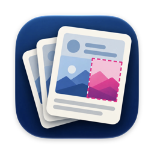
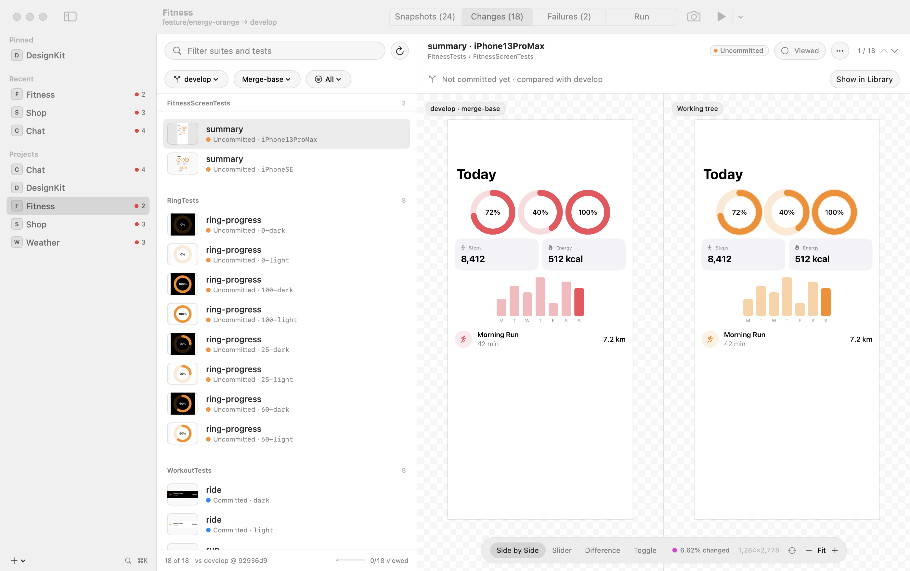
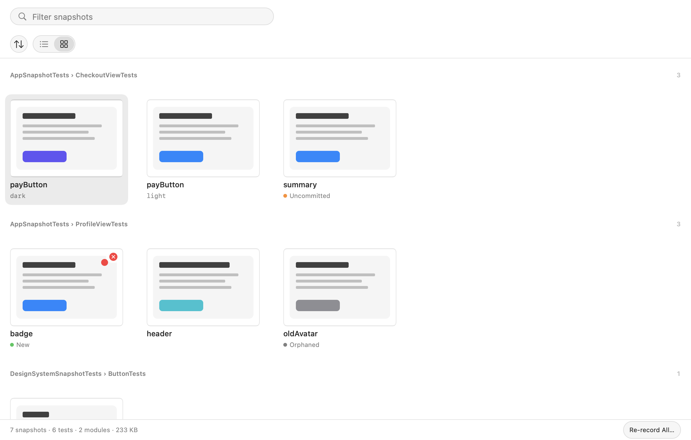
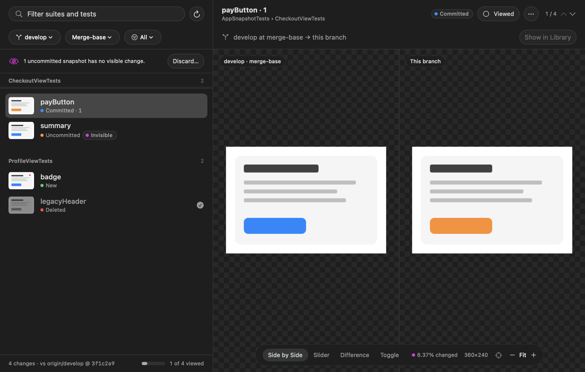
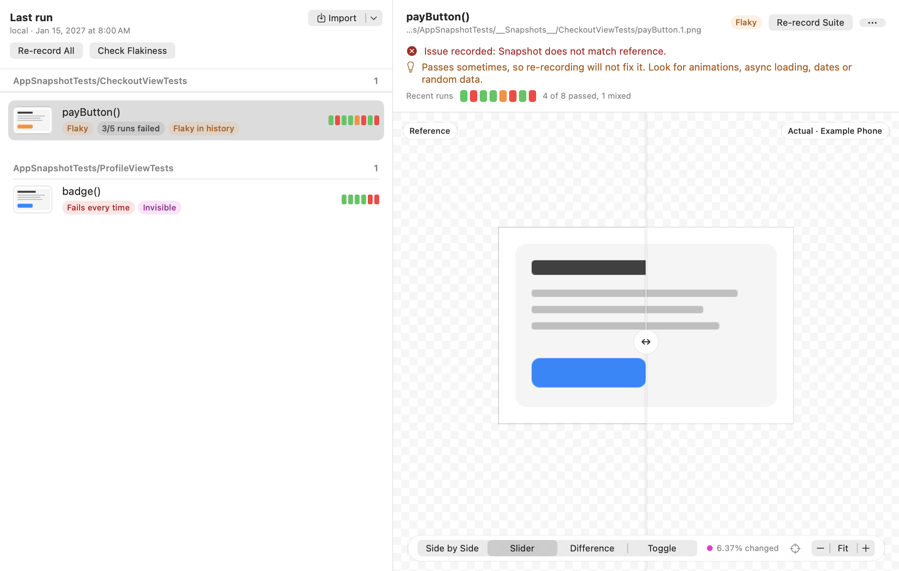
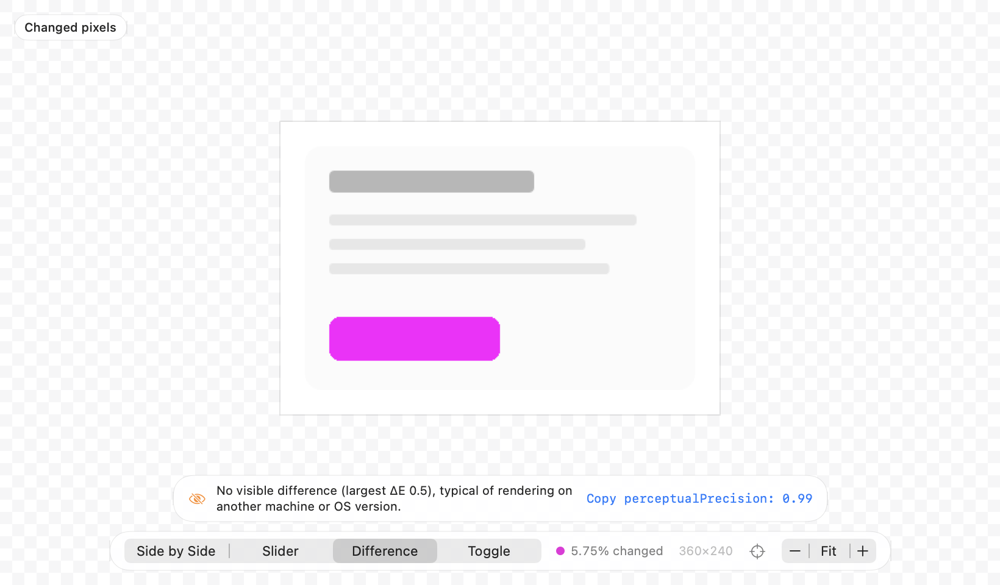

# SnapshotKit

**The companion app for projects that test with [swift-snapshot-testing](https://github.com/pointfreeco/swift-snapshot-testing).**

[](https://github.com/TobiasRe/SnapshotKit/actions/workflows/ci.yml)
[](https://github.com/TobiasRe/SnapshotKit/releases/latest)

[](LICENSE)

**[Website](https://tobiasre.github.io/SnapshotKit/) · [Documentation](https://tobiasre.github.io/SnapshotKit/docs/) · [Download](https://github.com/TobiasRe/SnapshotKit/releases/latest) · [Changelog](CHANGELOG.md)**



Your tests keep recording reference images as they do today. SnapshotKit, a macOS app with a menu bar item and
the `snapkit` CLI, works with them, with no package to add and no test code to change:

- **Browse and inspect** every snapshot in a project by module, test file and test, as a list with a large
  preview or as a grid. See variants (light/dark, devices, named states) side by side, a snapshot’s history
  across commits, its size, and the pixel under the pointer.
- **Review changes**: every snapshot that differs from the base branch, with side-by-side, slider, difference
  and toggle views, *Viewed* marks like a code review, and one-step discard of re-records that only picked up
  rendering noise.
- **Update**: re-record any test, suite or filtered set of snapshots (not just failing ones), with the source
  patch always restored and the result verified.
- **Manage**: find orphaned snapshots whose test is gone, the largest images, what’s new or modified; copy or
  drag snapshots and side-by-side comparisons into a review.
- **Failing and flaky tests** are part of the same picture: reference vs. actual vs. difference (also for an
  `.xcresult` from CI), a diagnosis of each difference (invisible, a few pixels, size changed) with the
  `precision`/`perceptualPrecision` that would pass, flakiness checks and each test’s recent runs.
- **Run like CI**, locally or on a CI machine over SSH, with exactly the configuration your pipeline uses.

## How it fits with swift-snapshot-testing

1. **You test with swift-snapshot-testing**: `assertSnapshot(of: view, as: .image)` in Swift Testing or XCTest.
2. **The tests record reference images**: PNGs in `__Snapshots__` folders next to the test files, committed to
   your repository.
3. **SnapshotKit works with them**: it finds the images, reads how CI runs the tests, shows changes and
   failures, and re-records by switching swift-snapshot-testing’s record mode on and off for you.

SnapshotKit isn’t a snapshot testing library and doesn’t replace swift-snapshot-testing. New to snapshot
testing? Start with [Point-Free’s library](https://github.com/pointfreeco/swift-snapshot-testing), then come back.

## Install

SnapshotKit runs on **Apple silicon Macs with macOS 14 or later**. The projects it tests need Xcode 16 or later
(for `xcresulttool get test-results`).

**The app:** download `SnapshotKit-<version>-macos-arm64.zip` from the
[latest release](https://github.com/TobiasRe/SnapshotKit/releases/latest), unzip it, and move
`SnapshotKit.app` to Applications. The app is ad-hoc signed, not notarized, so macOS blocks the first launch:
open it once, then choose **Open Anyway** in System Settings › Privacy & Security, or run
`xattr -dr com.apple.quarantine /Applications/SnapshotKit.app`.

**The `snapkit` CLI (optional):** download `snapkit-<version>-macos-arm64.zip` from the same release and put the
binary on your `PATH`:

```bash
unzip snapkit-0.2.0-macos-arm64.zip
sudo mkdir -p /usr/local/bin && sudo mv snapkit /usr/local/bin/
xattr -d com.apple.quarantine /usr/local/bin/snapkit 2>/dev/null || true
```

**From source** (Xcode 26 or later):

```bash
git clone https://github.com/TobiasRe/SnapshotKit.git && cd SnapshotKit
scripts/make-app.sh          # builds dist/SnapshotKit.app and dist/snapkit
open dist/SnapshotKit.app
```

See [Getting started](https://tobiasre.github.io/SnapshotKit/docs/getting-started/) for the details.

## Quick start

Add a repository (⌘O, or drop its folder onto the window), or a folder to scan (sidebar **+** › Add Scan
Folder, or drop a folder that isn’t a repository). Scanning looks six folders deep for git repositories with
`__Snapshots__` images, a `.snapshotkit.yml`, or a dependency on swift-snapshot-testing, and says what it
found. A project opens on its snapshot library. The sidebar shows each project’s failing count from its
last run.

| Shortcut | Action |
|---|---|
| ⌘R | Run snapshot tests |
| ⇧⌘R | Re-record the selected test (snapshot, change or failure) |
| ⌥⇧⌘R | Re-record the failing suites of the last run |
| ⌥⌘R | Check flakiness of failing tests |
| ⌃⌘R | Run on the remote machine |
| ⌘. | Cancel |
| ⇧⌘O | Import an `.xcresult` (e.g. a CI artifact) |
| ⌘K | Go to a project or run a command |
| ⌘F | Filter the list (Escape clears the filter, then leaves the field) |
| ⌥⌘1 – ⌥⌘4 | Snapshots / Changes / Failures / Run |
| ⌘1 – ⌘4 | Side by side / slider / difference / toggle |
| ⌘= / ⌘− / ⌘0 | Zoom in / out / to fit. Pinch to zoom, two-finger or mouse drag to pan, double-click to fit |
| ⇧⌘0 | Zoom to the changed pixels |
| ← / → | Move the slider divider in Slider mode (or drag its knob) |
| Space | Quick Look the selected item; in Toggle mode, flip between the images |
| ⌘C | Copy the selected image (in a list) |
| ⌥⌘O | Open the selected snapshot’s test in Xcode, at its function |
| ⌥⌘↓ / ⌥⌘↑ | Next / previous snapshot, change or failure, wherever the focus is |
| V (in the list), ⌥⌘V | Toggle a change’s *Viewed* mark; marking it viewed goes to the next one |

In the library, filter by name and narrow to **Changed**, **Failing**, **Uncommitted** or **Orphaned**
snapshots; sort by size or recency; switch between list and grid. A snapshot’s detail lists its variants
and committed versions to compare against, and links to its change or failure. The footer’s
**Re-record All…** (or **Re-record N Shown…** when filtered) records everything the list shows (say, every
`dark` variant). The arrow beside the toolbar’s Run button re-records the failing suites or every snapshot test
in one step.

Right-click a snapshot, change or failure to re-record its test or suite, copy the image or a side-by-side
comparison, open or reveal it, or jump to it in another view. The Changes tab picks the base branch from a
menu and can revert any change to it. The Dock icon shows the failing count, and bounces when a run finishes
in the background.

**Menu bar (optional).** Turn on *Show in menu bar* in Settings for a menu bar item that fills like a pie
as tests complete (with a done/total count) and otherwise shows the failing count. Its panel shows live
progress for every running project with Cancel, and your failing, pinned and recent projects to open or run
in one click. With it on, SnapshotKit keeps running when you close its window.

## The command line

The same features are in `snapkit`:

```bash
snapkit snapshots --sort size             # every snapshot with size and state, plus totals
snapkit snapshots --orphans               # snapshots whose test no longer exists
snapkit record CardTests dark             # re-record the tests of matching snapshots, then verify
snapkit config            # show the resolved configuration and where each value came from
snapkit run               # run like CI; exits 1 on failures and names failing suites
snapkit rerecord          # re-record the last run's failing suites and verify
snapkit flaky --iterations 10
snapkit failures --xcresult ~/Downloads/ci.xcresult   # diagnoses each failure, shows recent runs
snapkit history 'AppSnapshotTests/CardTests/card()'   # one test's runs: ✔ ✘ ◐
snapkit diff reference.png failure.png                # "No visible difference … perceptualPrecision: 0.99"
snapkit open reference.png failure.png                # the same, then compare them in SnapshotKit
snapkit changes --filter dark
snapkit run --remote      # on the machine in remoteHost
```

See [the CLI reference](https://tobiasre.github.io/SnapshotKit/docs/cli/).

### Use SnapshotKit as your diff tool

swift-snapshot-testing ends a failure message with a command for your diff tool, given the reference and
the image the test produced. Make that command `snapkit open` and it opens the pair in a SnapshotKit compare
window (side by side, slider, difference, toggle and the diagnosis), with **Show in Project** to jump to
the snapshot in its library:

```swift
extension SnapshotTestingConfiguration.DiffTool {
    // Quotes the paths; a plain "snapkit open" string would get them unquoted.
    static let snapkit = Self { "snapkit open \"\($0)\" \"\($1)\"" }
}

// Swift Testing: on a suite, or a base suite the others nest in
@Suite(.snapshots(diffTool: .snapkit))
struct CheckoutViewTests { … }

// XCTest: in a shared base class
override func invokeTest() {
    withSnapshotTesting(diffTool: .snapkit) { super.invokeTest() }
}
```

The message then ends in `snapkit open "<reference>" "<actual>"`: copy it from Xcode’s Report navigator and
run it in Terminal. It prints the same summary as `snapkit diff` and opens SnapshotKit.app. See
[Using SnapshotKit as your diff tool](https://tobiasre.github.io/SnapshotKit/docs/diff-tool/).

## How it works

**Configuration.** SnapshotKit reads `.gitlab-ci.yml`, `.github/workflows/*.yml` and the scripts they call, and
runs `xcodebuild` with the same scheme, test plan, test selection, simulator and Xcode version; anything can be
overridden in `.snapshotkit.yml`. See [Configuration](https://tobiasre.github.io/SnapshotKit/docs/configuration/).

**Re-recording.** SnapshotKit switches swift-snapshot-testing’s record mode on in the test source, runs just the
chosen tests, restores the source (also on cancel, quit, a signal, or at the next launch after a crash), and
runs the tests again to verify. See [Re-recording](https://tobiasre.github.io/SnapshotKit/docs/re-recording/).

**Remote runs.** With `remoteHost` set, it runs, re-records and checks flakiness on another Mac over SSH, so
references are rendered where CI compares them. See
[Remote runs](https://tobiasre.github.io/SnapshotKit/docs/remote-runs/).

**Noise or a real change?** Every difference is classified as invisible, a few pixels, size changed or visible,
with the `perceptualPrecision`, `precision` or both that would pass. See
[Comparing images](https://tobiasre.github.io/SnapshotKit/docs/comparing/#the-diagnosis).

## Screenshots

| The library | Changes |
|---|---|
|  |  |
| The library as a contact sheet: every snapshot at a glance | Changes since the base branch, with *Viewed* marks |

| Failures | Diagnosis |
|---|---|
|  |  |
| Failures: what kind of difference each one is, and its recent runs | Rendering noise, explained, with the precision that would pass |

## Development

```bash
swift test                              # core unit tests + the app's own snapshot tests
scripts/e2e.sh [--keep]                 # end to end against a real simulator (sample package, ~10 min;
                                        #   E2E_SIMULATOR="<name>" picks the simulator)
scripts/capture-ui.sh <repo> [out-dir]  # headless full-window screenshots of every view
scripts/check-runtime-warnings.sh       # fails on SwiftUI/AppKit runtime warnings (Xcode's purple ones)
scripts/make-samples.sh [dest]          # five sample projects with ~140 recorded snapshots to try the app on
mkdocs serve                            # the documentation at localhost:8000 (pip install -r requirements-docs.txt)
```

`make-samples.sh` creates Shop, Weather, Chat, Fitness and DesignKit (Swift packages using
swift-snapshot-testing, each a git repository) next to this repository, records their references on a
dedicated simulator, and gives four of them a feature branch with committed and uncommitted changes, a
failing last run, an orphaned and a new snapshot. Add the folder as a scan folder to try every tab.

The app’s UI is covered by snapshot tests (swift-snapshot-testing with Swift Testing) in
`Tests/SnapshotKitAppTests`. They render real views from fixture state in light and dark. Liquid Glass
can’t be composited off-screen, so those renders use an opaque stand-in and leave out the system toolbar
and sidebar chrome. To update references, delete the PNG or set `record: .all`, or re-record them with
SnapshotKit itself. Visual guidelines are in [docs/design.md](docs/design.md).

Repository layout and naming: the Swift package follows SwiftPM conventions: `Sources/` and `Tests/` with one
PascalCase folder per target (`SnapshotKitCore`, `SnapshotKit`, `SnapshotKitCLI`, which builds the `snapkit`
executable), PascalCase Swift files, and the `__Snapshots__` folders swift-snapshot-testing expects. Everything
else is lowercase kebab-case: `docs/` (with rendered images in `docs/images/`), `scripts/`, `site/` for the
website (a single static page; `.github/workflows/pages.yml` deploys it to GitHub Pages together with `docs/`
built by MkDocs under `/docs/`), and `assets/` for
source artwork such as `assets/app-icon.icon` (an Icon Composer file, compiled by `scripts/make-app.sh`; the
`Assets/` folder inside it is Icon Composer’s format). Root files keep their usual names (`README.md`,
`LICENSE`, `CHANGELOG.md`, `Package.swift`).

`SnapshotKitCore` holds all the logic: config, process runner, xcresult parser, git, record-patch manager,
remote runner and project store. `SnapshotKit` (SwiftUI) and `SnapshotKitCLI` (`snapkit`) are thin front ends.
`SnapshotKit --capture out.png --project <repo> --tab changes --compare slider --zoom 3` renders the window
off-screen without activating the app.

## License

MIT, see [LICENSE](LICENSE). Not affiliated with Point-Free.
