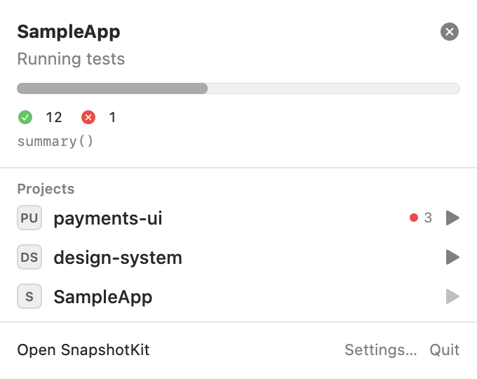

# The menu bar item

SnapshotKit can live in the menu bar, so you see how a run is going — and what's failing — while you work in
Xcode, without switching windows.

## Turning it on

**Settings › General › Show in menu bar.** With it on, SnapshotKit keeps running when you close its window:
runs continue, and the menu bar item reopens the window. With it off, closing the last window quits the app.

## The icon

| State | The icon shows |
|---|---|
| Nothing running | the SnapshotKit symbol (a stack of pictures) |
| Nothing running, tests failing | the symbol and the number of failing tests across your projects |
| A run in progress | a pie that fills as tests complete, and `done/total` (e.g. `13/30`); a quarter arc while the total isn't known yet |

The icon is a template image, so it follows the menu bar's color in light and dark mode and with a colored
wallpaper.

## The panel

Click the icon for a panel:

**Running** — for every project with a run in progress: its name, what it's doing (*Running tests*,
*Re-recording on ci-mac*…), a progress bar, the passed and failed counts so far, the test running now, and ⊗ to
cancel it.

**Projects** — your failing projects first (with *3 failing*), then pinned and recent ones. Click a project to
open it in the window; click ▶ to run its snapshot tests right away (the project opens and starts running once
its environment is checked).

**Footer** — **Open SnapshotKit** brings the window forward, **Settings…** opens the settings, **Quit** quits.

## Related

- The **Dock icon** shows the failing count of the open project as a badge, and bounces when a run finishes
  while SnapshotKit is in the background.
- The **sidebar** shows each project's failing count from its last run.
